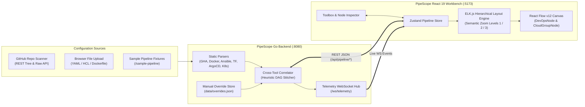

<div align="center">

# PipeScope

### Unified CI/CD & Cloud Infrastructure Pipeline Visualizer

[](https://go.dev/)
[](https://react.dev/)
[](https://www.typescriptlang.org/)
[](https://reactflow.dev/)
[](https://tailwindcss.com/)
[](https://www.docker.com/)

**PipeScope** statically parses heterogeneous DevOps and Cloud Infrastructure-as-Code (IaC) configurations, automatically correlates implicit cross-tool hand-offs into a single Directed Acyclic Graph (DAG), renders multi-layered interactive topology diagrams, and supports hybrid manual architecture overrides with live WebSocket telemetry simulation.

[Key Features](#-key-features) • [System Architecture](#-system-architecture) • [Cross-Tool Correlation Engine](#-cross-tool-correlation-engine) • [Quick Start](#-quick-start) • [API Reference](#-rest--websocket-api-reference) • [Data Contract](#-unified-graph-json-contract)

</div>

---

## 📖 Overview

Modern cloud-native delivery pipelines are fragmented across multiple declarative configuration formats—**GitHub Actions** triggers container builds, **Dockerfiles** package artifacts, **Terraform** provisions cloud networks/clusters/registries, **Ansible** configures virtual machines, **Argo CD** watches Git repositories, and **Kubernetes** manifests define runtime workloads.

**PipeScope** bridges the visibility gap across these tools without requiring invasive agents inside production clusters:
1. **Static Multi-Tool Parsing**: Directly analyzes `.github/workflows/*.yml`, `Dockerfile`, `ansible/playbook.yml`, `terraform/*.tf`, `argocd/application.yaml`, and `k8s/*.yaml`.
2. **Heuristic Cross-Tool Stitching**: Infers implicit dependencies (such as matching Docker image repositories between CI jobs, ECR/ACR registries, and Kubernetes `Deployment` specs, or nesting Kubernetes workloads inside Terraform-provisioned AWS EKS / Azure AKS clusters).
3. **3-Tier Semantic Zooming**: Seamlessly switch between an **Executive Stage Flow (Level 1)**, **Jobs & Services View (Level 2)**, and **Full Granular Infrastructure Topology (Level 3)** powered by hierarchical **ELK.js** layout computation.
4. **Hybrid Architecture Workbench**: Drag-and-drop custom nodes from the Architecture Toolbox, draw persisted `manual_link` edges between handles, edit node metadata in the Inspector, and export architecture snapshots to **JSON** or **PNG**.
5. **Real-Time Telemetry Simulation**: Stream 6-stage CI/CD execution updates over **WebSockets** (`/ws/telemetry`) with animated edges and status rollups.

---

## ✨ Key Features

| Capability | Description |
| :--- | :--- |
| **Static Config Parsers** | Dedicated AST/YAML/HCL parsers for **GitHub Actions**, **Dockerfile**, **Ansible**, **Terraform (HCLv2)**, **Argo CD**, and **Kubernetes**. |
| **Cross-Tool Stitcher** | Automatically links CI jobs, container artifacts, cloud registries (ECR/ACR), IaC resources, GitOps controllers, and K8s workloads with human-readable `correlation_reason` explanations. |
| **Cloud Boundary Nesting** | Groups cloud resources into hierarchical visual boundaries (`vpc`, `vnet`, `eks_cluster`, `aks_cluster`, `namespace`) using compound React Flow parent-child nodes. |
| **3 Semantic Zoom Levels** | **Level 1**: Executive stage summary cards with live status rollup.<br>**Level 2**: Core CI jobs, artifacts, and runtime services.<br>**Level 3**: Full infrastructure topology including VPCs, subnets, IAM, security groups, and VMs. |
| **Hybrid Manual Editing** | Drag nodes from the left **Architecture Toolbox**, draw custom `manual_link` edges, reposition nodes, and edit metadata. Persisted in `backend/data/overrides.json` across re-scans. |
| **GitHub Repo Scanner & File Upload** | Scan any public or private GitHub repository by URL/branch/token or upload/edit raw configuration snippets directly in the browser. |
| **Live WebSocket Simulation** | Trigger a 6-phase pipeline execution simulation (`source` → `ci` → `artifact` → `iac_and_config_mgmt` → `gitops` → `runtime_and_cloud`) streamed in real time via WebSocket. |

---

## 🏗 System Architecture



---

## 🔗 Cross-Tool Correlation Engine

PipeScope's correlator (`backend/internal/correlator/stitcher.go`) executes five deterministic linking passes after deduplicating partial graphs:

1. **GitHub Actions ↔ Dockerfile & Container Registry (`linkGitHubActionsAndDocker`)**
   - Links GitHub webhook source nodes (`github`) to root workflow jobs (`triggers`).
   - Connects CI jobs running `docker build` / `docker/build-push-action` to Docker image artifact nodes (`builds_image`) and matches `image_repo` against Terraform-provisioned ECR/ACR registries (`pushes_to`).
2. **GitHub Actions ↔ Ansible & Terraform (`linkGitHubActionsToAnsibleAndTerraform`)**
   - Connects CI jobs invoking `ansible-playbook` to matching Ansible Playbook nodes (`triggers`).
   - Connects CI jobs executing `terraform apply` to root Terraform infrastructure resources (`triggers`).
3. **Docker Artifact ↔ Kubernetes Workloads (`linkDockerToKubernetes`)**
   - Matches container image repositories/tags built in Docker/CI against Kubernetes `Deployment` and `StatefulSet` pod specifications (`pushes_to`).
4. **Argo CD ↔ Git Repository & Kubernetes Manifests (`linkArgoCDToGitAndKubernetes`)**
   - Links GitHub source repositories to Argo CD `Application` resources (`watches repo`) and connects Argo CD `spec.source.path` (`sync_path`) to Kubernetes manifests in matching directories (`syncs_manifest`).
5. **Terraform Cloud Infrastructure ↔ Kubernetes & Ansible (`linkTerraformCloudToKubernetesAndAnsible`)**
   - Automatically nests Kubernetes workloads inside provisioned `aws_eks_cluster` or `azurerm_kubernetes_cluster` boundary groups (`hosts workload`).
   - Matches Ansible `hosts:` targets against Terraform compute instances (`aws_instance`, `azurerm_linux_virtual_machine`) (`deploys_to`).

---

## 📂 Repository Structure

```text
devops-pipeline-visualizer/
├── backend/                        # Go 1.23+ Backend API & Static Analysis Engine
│   ├── cmd/server/main.go          # HTTP & WebSocket server entrypoint
│   ├── internal/
│   │   ├── api/                    # Chi REST handlers, CORS, & Gorilla WebSocket hub
│   │   ├── correlator/             # Cross-tool DAG stitcher & manual override merger
│   │   ├── graph/                  # Canonical PipelineGraph model & builder utilities
│   │   └── parsers/                # Static parsers (GHA, Dockerfile, Ansible, TF, ArgoCD, K8s)
│   ├── Dockerfile                  # Multi-stage Go container build
│   └── go.mod
├── frontend/                       # React 19 + TypeScript + Vite Interactive Workbench
│   ├── src/
│   │   ├── components/
│   │   │   ├── nodes/              # Custom React Flow nodes (DevOpsNode, CloudGroupNode)
│   │   │   ├── HeaderBar.tsx       # Repo scanner modal, simulation trigger, JSON/PNG export
│   │   │   ├── ToolboxSidebar.tsx  # Draggable node templates & manual edge labeler
│   │   │   ├── PipelineCanvas.tsx  # React Flow canvas, semantic zoom bar, live telemetry HUD
│   │   │   └── NodeInspector.tsx   # Metadata editor, dependency navigator & correlation viewer
│   │   ├── store/                  # Zustand state management & WebSocket client
│   │   ├── types/                  # Strict TypeScript interfaces matching Go JSON schema
│   │   └── utils/                  # ELK.js hierarchical layout & stage status rollup
│   ├── Dockerfile                  # Multi-stage Node build + Nginx reverse proxy
│   ├── nginx.conf                  # Proxies /api and /ws to backend service
│   └── package.json
├── sample-pipeline/                # Multi-tool fixture repository for instant demo & testing
│   ├── .github/workflows/deploy.yml
│   ├── ansible/playbook.yml
│   ├── argocd/application.yaml
│   ├── k8s/deployment.yaml
│   ├── terraform/main.tf
│   └── Dockerfile
└── docker-compose.yml              # One-command full-stack container orchestration
```

---

## 🚀 Quick Start

### Option 1: Run with Docker Compose (Recommended)

Ensure [Docker Desktop](https://www.docker.com/products/docker-desktop/) is running, then launch both services from the repository root:

```bash
docker compose up --build
```

- **Frontend Workbench**: [http://localhost:5173](http://localhost:5173)
- **Backend API & Health Check**: [http://localhost:8080/api/health](http://localhost:8080/api/health)

---

### Option 2: Local Development Setup

#### Prerequisites
- **Go**: `1.23+`
- **Node.js**: `20+` and `npm`

#### 1. Start the Go Backend Server
```bash
cd backend
go mod download
go run ./cmd/server
```
The backend server will start on `http://localhost:8080` and automatically locate `../sample-pipeline`.

#### 2. Start the React + Vite Frontend
Open a second terminal:
```bash
cd frontend
npm install
npm run dev
```
Open [http://localhost:5173](http://localhost:5173) in your browser. Vite proxies `/api/*` and `/ws/*` requests to `http://localhost:8080`.

---

## 🧪 Running Tests

### Backend Unit & Integration Tests
The Go backend includes comprehensive test suites covering CI parsers, infrastructure parsers, cross-tool DAG stitching, graph deduplication, and REST/WebSocket handlers:

```bash
cd backend
go test -v ./...
```

### Frontend Type-Check & Production Build
```bash
cd frontend
npm run build
```

---

## 📡 REST & WebSocket API Reference

| Method | Endpoint | Description |
| :--- | :--- | :--- |
| `GET` | `/api/health` | Service health check and UTC timestamp. |
| `GET` | `/api/pipeline/sample` | Scans `/sample-pipeline`, applies saved manual overrides, and returns the unified `PipelineGraph`. |
| `POST` | `/api/pipeline/parse-files` | Parses an array of `{ "path": "...", "content": "..." }` objects (or `{ "directory_path": "..." }`) and returns the stitched DAG. |
| `POST` | `/api/pipeline/scan-github` | Recursively fetches DevOps config files from a GitHub repository (`repo_url`, `branch`, optional `github_token`) and correlates them into a unified DAG. |
| `POST` | `/api/pipeline/manual-override` | Persists custom nodes, custom `manual_link` edges, node deletions, or canvas coordinates to `data/overrides.json` and broadcasts updates. |
| `POST` | `/api/pipeline/simulate-run` | Starts an asynchronous 6-stage CI/CD pipeline execution simulation across the active graph. |
| `GET` | `/ws/telemetry` | WebSocket endpoint streaming real-time `telemetry_update`, `graph_updated`, and `simulation_completed` events. |

### Example: Parse Custom Configuration Files via cURL

```bash
curl -X POST http://localhost:8080/api/pipeline/parse-files \
  -H "Content-Type: application/json" \
  -d '[
    {
      "path": ".github/workflows/ci.yml",
      "content": "name: CI\non: [push]\njobs:\n  build:\n    runs-on: ubuntu-latest\n    steps:\n      - uses: docker/build-push-action@v5\n        with:\n          tags: ghcr.io/acme/payment-api:v1"
    },
    {
      "path": "k8s/deployment.yaml",
      "content": "apiVersion: apps/v1\nkind: Deployment\nmetadata:\n  name: payment-api\nspec:\n  template:\n    spec:\n      containers:\n        - name: api\n          image: ghcr.io/acme/payment-api:v1"
    }
  ]'
```

---

## 📐 Unified Graph JSON Contract

Both the Go backend (`backend/internal/graph/model.go`) and TypeScript frontend (`frontend/src/types/graph.ts`) strictly enforce the following schema:

```json
{
  "id": "pipescope-unified",
  "name": "Unified DevOps Pipeline",
  "updated_at": "2026-11-17T12:00:00Z",
  "nodes": [
    {
      "id": "gha-job-build-and-push",
      "label": "GHA Job: build-and-push",
      "stage": "ci",
      "tool": "github_actions",
      "status": "idle",
      "zoom_level": 2,
      "parent_group_id": "",
      "position": { "x": 340, "y": 180 },
      "is_manual": false,
      "metadata": {
        "file_path": ".github/workflows/deploy.yml",
        "image_repo": "123456789012.dkr.ecr.us-east-1.amazonaws.com/pipescope-api",
        "container_image": "123456789012.dkr.ecr.us-east-1.amazonaws.com/pipescope-api:latest",
        "correlation_reason": "Triggered by GitHub push/PR webhook"
      }
    }
  ],
  "edges": [
    {
      "id": "gha-job-build-and-push->docker-image:builds_image",
      "source": "gha-job-build-and-push",
      "target": "docker-image",
      "relation_type": "builds_image",
      "animated": false,
      "label": "builds image",
      "is_manual": false
    }
  ],
  "groups": [
    {
      "id": "tf-group-aws-eks-main",
      "label": "AWS EKS Cluster: prod-eks-cluster",
      "provider": "aws",
      "resource_type": "eks_cluster",
      "parent_group_id": "tf-group-aws-vpc-main"
    }
  ]
}
```

### Supported Enum Values
- **`stage`**: `source` | `ci` | `config_mgmt` | `artifact` | `iac` | `gitops` | `runtime` | `cloud`
- **`tool`**: `github` | `github_actions` | `ansible` | `docker` | `terraform` | `argocd` | `kubernetes` | `aws` | `azure`
- **`status`**: `idle` | `running` | `success` | `failed` | `out_of_sync`
- **`relation_type`**: `triggers` | `builds_image` | `pushes_to` | `provisions` | `syncs_manifest` | `deploys_to` | `manual_link`
- **`provider`**: `aws` | `azure` | `kubernetes`
- **`resource_type`**: `vpc` | `vnet` | `eks_cluster` | `aks_cluster` | `namespace`

---

## 📄 License

Distributed under the MIT License.
